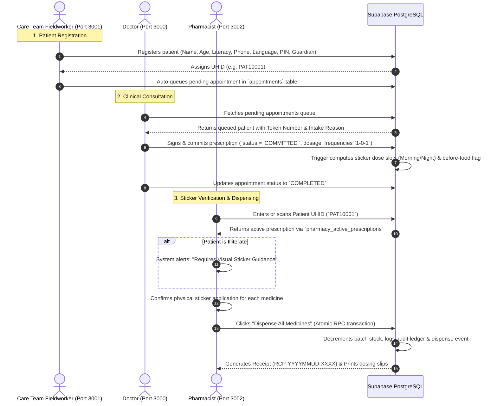

# CuraLink — Connected Healthcare Ecosystem (Wholly Next.js)

CuraLink connects **Care Team Fieldworkers**, **Doctors**, and **Pharmacists** into an interconnected clinical workflow backed by **Supabase PostgreSQL**.

---

## 🏗️ Architecture & Portals

All three portals are 100% **Next.js** applications designed to run simultaneously on dedicated local ports:

| Portal | Role | Directory | Port | Primary Features |
|---|---|---|---|---|
| **Care Team Portal** | ASHA Fieldworkers | [`careteam/`](file:///home/anijois/Documents/SEM%203/HACKATHONS/mockmerge2/careteam) | `http://localhost:3001` | Patient registration, literacy & caregiver capture, UHID generation, automatic consultation queueing |
| **Doctor Portal** | Clinical Specialists | [`doctor/`](file:///home/anijois/Documents/SEM%203/HACKATHONS/mockmerge2/doctor) | `http://localhost:3000` | Real-time pending appointments queue, clinical consultation desk, medication regimens, sticker slot planning, diagnostics orders |
| **Pharmacy Portal** | Pharmacists | [`pharmacy/`](file:///home/anijois/Documents/SEM%203/HACKATHONS/mockmerge2/pharmacy) *(symlink `pharmcy`)* | `http://localhost:3002` | Patient UHID lookup, visual sticker verification (Morning/Afternoon/Night/Before Food), inventory batch deduction, atomic dispensing & receipt |

---

## 🔄 End-to-End Clinical Flow



---

## ⚡ Quick Start

### 1. Install Dependencies
```bash
# Install all 3 portals in one command
npm run install:all
```

### 2. Configure Supabase (.env.local)
In each portal directory (`careteam/`, `doctor/`, `pharmacy/`), copy `.env.example` to `.env.local` and configure your Supabase credentials:

```bash
NEXT_PUBLIC_SUPABASE_URL=https://your-project.supabase.co
NEXT_PUBLIC_SUPABASE_ANON_KEY=your-anon-key
```

### 3. Run the Portals
Open three terminal tabs (or run from root):
```bash
# Terminal 1: Doctor Portal (Port 3000)
npm run dev:doctor

# Terminal 2: Care Team Portal (Port 3001)
npm run dev:careteam

# Terminal 3: Pharmacy Portal (Port 3002)
npm run dev:pharmacy
```

---

## 🗄️ Supabase Setup Instructions

See [`SUPABASE_SETUP.md`](file:///home/anijois/Documents/SEM%203/HACKATHONS/mockmerge2/SUPABASE_SETUP.md) for full step-by-step instructions and the master schema [`supabase_master_schema.sql`](file:///home/anijois/Documents/SEM%203/HACKATHONS/mockmerge2/supabase_master_schema.sql).
