# CURALINK — Complete Doctor Portal Implementation Plan
**Based on the Official Hackathon Project Report & Clean Architecture Specification**

---

## 1. Executive Summary & Architectural Alignment

**CURALINK** is an integrated healthcare coordination and color-voice adherence platform. The **Doctor Portal** serves as the system's primary clinical authority. In accordance with the project specification (Sections 1–4, 7, 10, and 16 of the report), the Doctor Portal is not an isolated EMR; it is a clinical coordination hub with six non-negotiable architectural mandates:

1. **Clean / Hexagonal Architecture**: Strict separation of Core Domain rules, Application Use Cases, Interface Adapters, and Frameworks/Infrastructure.
2. **Literacy-Aware Patient Profiling**: Capturing literacy (`LITERATE` vs `ILLITERATE`), interface (`SMARTPHONE` vs `FEATURE_PHONE`), language, and caregiver consent at registration. This drives the downstream multilingual TTS voice engine and physical color stickers.
3. **Database-Enforced Prescription Immutability**: Committed prescriptions are locked at the database layer (PostgreSQL triggers reject `UPDATE` and `DELETE`). Changes spawn append-only revisions (`v1 -> v2`) linked via `parent_prescription_id`.
4. **Human-in-the-Loop AI Oversight**: AI-extracted clinical tasks from IVR calls remain `PROPOSED` until the doctor reviews and approves, rejects, or amends them.
5. **Controlled Pharmacy Substitution Gate**: Pharmacist proposals for out-of-stock substitutes cannot be dispensed until the prescribing doctor approves them, automatically generating a traceable prescription revision.
6. **Dual-Escalation Safety Net**: Three consecutive qualifying unanswered calls trigger simultaneous alerts on both the treating Doctor's dashboard and the Hospital care-coordination workstation.

---

## 2. Clean Architecture Layer Mapping (Hexagonal Architecture)

As prescribed in Section 7 of the report, the implementation follows Clean Architecture:

```
┌────────────────────────────────────────────────────────────────────────┐
│ 1. FRAMEWORKS & INFRASTRUCTURE                                         │
│    - Next.js 14 (App Router), React Server Components, Tailwind CSS   │
│    - PostgreSQL (Supabase / Docker), Prisma ORM / pg client           │
│    - Telephony Gateway Adapter (Twilio / Exotel webhooks)             │
│    - Speech Engines (faster-whisper, ElevenLabs / EdgeTTS)            │
│    - LLM Inference (Ollama LLaMA 3.2 / Gemini API)                    │
└───────────────────────────────────┬────────────────────────────────────┘
                                    ▼
┌────────────────────────────────────────────────────────────────────────┐
│ 2. INTERFACE ADAPTERS                                                  │
│    - REST Controllers & Server Actions (/api/v1/doctor/*)              │
│    - Webhook Handlers (Telephony callbacks, IVR DTMF gather)           │
│    - SQL Repository Implementations (PrismaDoctorRepository)           │
│    - Event Emitters / SSE Presenters (Dual-Escalation Dispatcher)      │
└───────────────────────────────────┬────────────────────────────────────┘
                                    ▼
┌────────────────────────────────────────────────────────────────────────┐
│ 3. APPLICATION USE CASES                                               │
│    - RegisterPatientUseCase (with literacy & guardian consent)         │
│    - DraftPrescriptionUseCase & CommitPrescriptionUseCase              │
│    - CreatePrescriptionRevisionUseCase                                 │
│    - ReviewAiCandidateTaskUseCase (Approve / Amend / Dismiss)          │
│    - ApprovePharmacySubstitutionUseCase                                │
│    - TriggerDualEscalationUseCase (Threshold >= 3 missed calls)       │
│    - ScheduleAppointmentCountdownUseCase (T-24h, T-1h, T-30m)         │
└───────────────────────────────────┬────────────────────────────────────┘
                                    ▼
┌────────────────────────────────────────────────────────────────────────┐
│ 4. CORE DOMAIN                                                         │
│    - Entities: Doctor, Patient, Prescription (Aggregate), Medicine     │
│    - Value Objects: LiteracyProfile, DosageSchedule, StickerBinding   │
│    - Domain Events: PrescriptionCommitted, EscalationTriggered        │
│    - Invariants: CommittedPrescriptionCannotMutate, MaxRetriesReached │
└────────────────────────────────────────────────────────────────────────┘
```

---

## 3. Directory Structure

```
arogyavani/
├── app/                                 # Framework & UI (Next.js App Router)
│   ├── (auth)/                          # Role-based login & session gate
│   │   └── login/page.tsx
│   ├── doctor/                          # DOCTOR PORTAL ROOT
│   │   ├── layout.tsx                   # TopNav, Doctor Profile, Escalation Alert Badge
│   │   ├── page.tsx                     # Doctor Dashboard (Command Center)
│   │   ├── patients/
│   │   │   ├── page.tsx                 # Patient Search & Directory
│   │   │   ├── new/page.tsx             # Literacy-Aware Registration Form
│   │   │   └── [id]/
│   │   │       ├── page.tsx             # Longitudinal Health & Adherence Chart
│   │   │       └── prescribe/page.tsx   # Prescription Studio (Draft / Revise)
│   │   ├── tasks/page.tsx               # AI Call-to-Task Triage Desk
│   │   ├── substitutions/page.tsx       # Pharmacy Substitution Approval Queue
│   │   └── escalations/page.tsx         # High-Risk Watchlist & Follow-up Actions
│   └── api/v1/                          # REST API & Webhooks (Appendix A compliant)
│       ├── patients/register/route.ts
│       ├── prescriptions/
│       │   ├── draft/route.ts
│       │   ├── [id]/commit/route.ts
│       │   ├── [id]/revise/route.ts
│       │   └── [id]/route.ts            # Enforces DELETE blocking (HTTP 405)
│       ├── pharmacy/propose-alternative/route.ts
│       ├── telephony/adherence-gather/route.ts
│       ├── escalations/trigger-threshold/route.ts
│       └── tasks/[id]/approve/route.ts
├── src/
│   ├── domain/                          # Core Domain Layer (Entities & Rules)
│   │   ├── patient.entity.ts
│   │   ├── prescription.aggregate.ts
│   │   ├── literacy-profile.vo.ts
│   │   └── adherence-log.vo.ts
│   ├── usecases/                        # Application Use Cases
│   │   ├── register-patient.ts
│   │   ├── commit-prescription.ts
│   │   ├── revise-prescription.ts
│   │   ├── review-ai-task.ts
│   │   └── process-substitution.ts
│   ├── adapters/                        # Interface Adapters
│   │   ├── db/prisma-prescription-repo.ts
│   │   ├── telephony/mock-telephony-gateway.ts
│   │   └── ai/ollama-task-extractor.ts
│   └── components/                      # Reusable UI Components
│       ├── ui/                          # shadcn/ui primitives
│       ├── doctor/
│       │   ├── LiteracyToggleCard.tsx
│       │   ├── PrescriptionLineageTree.tsx
│       │   ├── MedicineItemRepeater.tsx
│       │   ├── StickerColorBadge.tsx
│       │   ├── AiTaskTriageCard.tsx
│       │   ├── DualEscalationBanner.tsx
│       │   └── AdherenceTimelineFeed.tsx
├── prisma/
│   ├── schema.prisma                    # Data model mapping
│   ├── migrations/
│   │   └── 0001_immutability_trigger.sql# PostgreSQL trigger
│   └── seed.ts                          # Demo dataset (synthetic patients)
```

---

## 4. Suggested Data Model & PostgreSQL Immutability

### 4.1 Schema Definition (Prisma / SQL)

```prisma
datasource db {
  provider = "postgresql"
  url      = env("DATABASE_URL")
}

generator client {
  provider = "prisma-client-js"
}

enum Role {
  DOCTOR
  PATIENT
  PHARMACY
  HOSPITAL
  ADMIN
}

enum LiteracyStatus {
  LITERATE
  ILLITERATE
}

enum PreferredLanguage {
  KANNADA
  HINDI
  TAMIL
  TELUGU
  MARATHI
  ENGLISH
}

enum DeviceType {
  SMARTPHONE
  FEATURE_PHONE
}

enum PrescriptionStatus {
  DRAFT
  COMMITTED
  SUPERSEDED
}

enum ColorSticker {
  PINK
  BLUE
  YELLOW
  GREEN
  PURPLE
}

enum ShapeSymbol {
  CIRCLE
  TRIANGLE
  STAR
  SQUARE
}

enum DispenseStatus {
  PENDING
  DISPENSED
  SUBSTITUTED
}

enum TaskStatus {
  PROPOSED
  APPROVED
  REJECTED
  RESOLVED
}

enum AdherenceStatus {
  TAKEN_REPORTED
  HELP_REQUESTED
  SNOOZED
  NO_ANSWER
  PROVIDER_FAILED
}

model User {
  id                 String          @id @default(uuid())
  role               Role
  full_name          String
  phone_number       String          @unique
  medical_license_no String?
  department         String?
  created_at         DateTime        @default(now())

  prescriptions      Prescription[]  @relation("DoctorPrescriptions")
  reviewed_tasks     CareTask[]      @relation("DoctorReviewedTasks")
}

model Patient {
  id                 String            @id @default(uuid())
  patient_uhid       String            @unique // e.g. ARV-2026-001
  full_name          String
  age                Int
  gender             String
  phone_number       String            @unique
  literacy_status    LiteracyStatus    // Mandatory per Section 5.1
  preferred_language PreferredLanguage // Mandatory
  device_type        DeviceType        // SMARTPHONE or FEATURE_PHONE
  guardian_name      String?
  guardian_phone     String?
  guardian_consent   Boolean           @default(false)
  created_at         DateTime          @default(now())

  prescriptions      Prescription[]
  adherence_logs     AdherenceLog[]
  care_tasks         CareTask[]
  appointments       Appointment[]
}

model Prescription {
  id                     String               @id @default(uuid())
  patient_id             String
  doctor_id              String
  hospital_id            String?
  parent_prescription_id String?              // Self-relation: revision lineage
  revision_number        Int                  @default(1)
  status                 PrescriptionStatus   @default(DRAFT)
  diagnosis_notes        String               // Hidden from Pharmacy Portal
  clinical_instructions  String?
  follow_up_date         DateTime?
  committed_at           DateTime?
  created_at             DateTime             @default(now())

  patient                Patient              @relation(fields: [patient_id], references: [id])
  doctor                 User                 @relation("DoctorPrescriptions", fields: [doctor_id], references: [id])
  parent_prescription    Prescription?        @relation("PrescriptionLineage", fields: [parent_prescription_id], references: [id])
  child_revisions        Prescription[]       @relation("PrescriptionLineage")
  medicines              PrescriptionMedicine[]
  care_tasks             CareTask[]
  substitutions          SubstitutionProposal[]
}

model PrescriptionMedicine {
  id               String          @id @default(uuid())
  prescription_id  String
  medicine_name    String
  dosage           String          // e.g. "500mg"
  frequency        String          // e.g. "1-0-1 (After Food)"
  duration_days    Int             // e.g. 30
  color_sticker    ColorSticker?   // Assigned at pharmacy / recommended by doc
  symbol           ShapeSymbol?    // High-contrast accessibility symbol
  dispense_status  DispenseStatus  @default(PENDING)
  dispensed_at     DateTime?

  prescription     Prescription    @relation(fields: [prescription_id], references: [id])
}

model CareTask {
  id                   String      @id @default(uuid())
  patient_id           String
  prescription_id      String?
  source_type          String      // "AI_CALL_EXTRACT" | "DUAL_ESCALATION"
  title                String
  raw_transcript       String?     // Original call transcription
  ai_extracted_summary String?     // Structured JSON/Text extraction
  priority             String      // "LOW" | "MEDIUM" | "HIGH" | "CRITICAL"
  status               TaskStatus  @default(PROPOSED)
  reviewed_by          String?
  reviewed_at          DateTime?
  created_at           DateTime    @default(now())

  patient              Patient     @relation(fields: [patient_id], references: [id])
  prescription         Prescription? @relation(fields: [prescription_id], references: [id])
  reviewer             User?       @relation("DoctorReviewedTasks", fields: [reviewed_by], references: [id])
}

model SubstitutionProposal {
  id                       String    @id @default(uuid())
  prescription_id          String
  medicine_id              String
  pharmacist_id            String
  proposed_medicine_name   String
  reason_for_substitution  String
  status                   String    @default("PENDING") // PENDING, APPROVED, REJECTED
  doctor_rejection_reason  String?
  created_at               DateTime  @default(now())

  prescription             Prescription @relation(fields: [prescription_id], references: [id])
}

model AdherenceLog {
  id              String          @id @default(uuid())
  patient_id      String
  medicine_id     String?
  scheduled_time  DateTime
  status          AdherenceStatus
  response_mode   String          // "DTMF_1", "DTMF_2", "STT", "NO_ANSWER"
  provider_outcome String?        // "ANSWERED", "BUSY", "NETWORK_FAILED"
  attempt_count   Int             @default(1)
  recorded_at     DateTime        @default(now())

  patient         Patient         @relation(fields: [patient_id], references: [id])
}

model Appointment {
  id               String          @id @default(uuid())
  patient_id       String
  doctor_id        String
  appointment_time DateTime
  booking_channel  String          // "ONLINE_SMARTPHONE" | "INBOUND_IVR"
  status           String          // "CONFIRMED" | "COMPLETED" | "CANCELLED"
  created_at       DateTime        @default(now())

  patient          Patient         @relation(fields: [patient_id], references: [id])
}
```

### 4.2 PostgreSQL Immutability Trigger Execution

```sql
-- Migration: enforce_prescription_immutability
CREATE OR REPLACE FUNCTION check_prescription_immutability()
RETURNS TRIGGER AS $$
BEGIN
    -- If existing prescription is COMMITTED, forbid any UPDATE or DELETE
    IF OLD.status = 'COMMITTED' THEN
        RAISE EXCEPTION 'DATABASE RESTRICTION: Committed prescription % is legally locked and immutable. To change medications, issue a new revision pointing to parent_prescription_id %.', OLD.id, OLD.id
        USING ERRCODE = '23505';
    END IF;
    RETURN NEW;
END;
$$ LANGUAGE plpgsql;

CREATE TRIGGER trg_prescription_immutability
BEFORE UPDATE OR DELETE ON "Prescription"
FOR EACH ROW
EXECUTE FUNCTION check_prescription_immutability();
```

---

## 5. Doctor Portal Screen Workflows & Component Hierarchy

### Screen 1: Doctor Command Center (`/doctor`)
- **Metric Badges**:
  - `Active Patients`: Total enrolled patients.
  - `Critical Dual Escalations`: Red flashing badge when any patient reaches 3 unanswered calls.
  - `Pending AI Call Tasks`: Count of IVR calls with candidate actions requiring clinical review.
  - `Pharmacy Substitutions`: Count of pending generic brand change requests.
- **Urgent Action Deck (Split View)**:
  - **Left Deck — Escalation Watchlist**: Patient UHID, Name, Literacy Badge, Contact Phone, Missed Calls counter (`3/3`), Quick Actions: `[Call Patient]`, `[Review Lineage]`, `[Coordinate with Hospital]`.
  - **Right Deck — AI Call Tasks**: Audio player / transcript snippet, extracted symptom, confidence score, `[Review & Approve]` button.
- **Patient Quick-Search Bar**: Search by UHID, Name, or Phone + `[+ Register New Patient]` CTA.

### Screen 2: Literacy-Aware Registration Form (`/doctor/patients/new`)
- **Section A: Demographics**: Name, Age, Gender, Phone, Address.
- **Section B: Accessibility & Literacy Configuration (Core Arogyavani Feature)**:
  - **Literacy Radio Cards**:
    - 📖 **Literate**: Standard printed prescription, text SMS, smartphone app access.
    - 🗣️ **Illiterate / Low Literacy**: High-contrast color stickers + symbols, automated vernacular voice calls, audio instructions.
  - **Device Type**:
    - 📱 **Smartphone**: Visual adherence tracker, calendar sync.
    - 📞 **Feature Phone**: Keypad DTMF adherence confirmations, inbound IVR booking.
  - **Preferred Language**: Kannada, Hindi, Tamil, Telugu, Marathi, English.
  - **Guardian & Escalation Consent**: Caregiver Name, Phone, and Consent toggle to authorize calls after 2 failed attempts.

### Screen 3: Longitudinal Patient Chart & Adherence Timeline (`/doctor/patients/[id]`)
- **Patient Banner**: Displays UHID, Age, Gender, and prominent accessibility tags: `Low Literacy • Feature Phone • Kannada`.
- **Tab 1 — Prescription Lineage**:
  - Visual tree graph: `v1 (Superseded) ──> v2 (Active Committed)`.
  - Click on any revision to view exact medication snapshot, timestamps, and doctor notes.
- **Tab 2 — Adherence Feed with Honest Status Language**:
  - Displays scheduled doses paired with physical stickers:
    - 🔴 Metformin 500mg → `Red Sticker (Morning)`
    - 🔴 Amlodipine 5mg → `Red Sticker (Morning)`
  - Real-time log entries:
    - ✅ *"Patient-reported confirmation via DTMF 1 (08:02 AM)"*
    - ⚠️ *"No response received on attempt 1 (08:00 AM) — 15-min retry queued"*
    - 🆘 *"Help requested via DTMF 2 (Patient reported burning sensation in stomach)"*
- **Tab 3 — Diagnostics & Encounter History**: Lab tests, clinical observations.

### Screen 4: Prescription Studio (`/doctor/patients/[id]/prescribe`)
- **Header State**:
  - `Drafting v1` OR `Creating Revision v2 (Supersedes v1)`.
- **Medicine Repeater**:
  - Medicine search autocomplete (Metformin, Amlodipine, Telmisartan, etc.).
  - Dosage (`500mg`), Frequency (`1-0-1 After Food`), Duration (`30 Days`).
  - Recommended Sticker Color & Shape preview.
- **Clinical Notes & Instructions**:
  - Diagnosis notes (stored securely; strictly excluded from Pharmacy view).
  - Follow-up date picker (defaults to 30 days).
- **Commit Guard Modal**:
  - Click `[Save as Draft]`: Saves editable draft.
  - Click `[Commit & Lock]`: Modal alerts doctor:
    > *"Once committed, this prescription cannot be updated or deleted. Any future adjustments will require an append-only revision. This action activates the pharmacy dispensing queue and voice reminder schedule."*

### Screen 5: AI Call-to-Task Triage Desk (`/doctor/tasks`)
- Displays candidate tasks extracted from unstructured patient calls.
- **Card Elements**:
  - Audio snippet playback + Vernacular Kannada/Hindi transcript: *"Doctor saheb, nanna hotte thumba uri aagthide"* (Doctor, my stomach is burning).
  - **AI Extraction Card**:
    - Reported Symptom: *Acidity / Gastric discomfort after Metformin dose*
    - Proposed Action: *Add Antacid (Pantoprazole 40mg) or take with meals*
    - Urgency: *High*
  - **Doctor Action Gate**:
    - `[Approve as Care Task]`: Queues for hospital nurse follow-up.
    - `[Revise Prescription Now]`: Pre-fills Prescription Studio with Revision v2 adding Pantoprazole.
    - `[Reject / False Alarm]`: Dismisses with mandatory clinical reason.

### Screen 6: Pharmacy Substitution Gate (`/doctor/substitutions`)
- When the pharmacy is out of stock of a prescribed brand, the pharmacist proposes a substitute.
- Shows:
  - Prescribed: *Glucophage 500mg*
  - Proposed Substitute: *Glycomet 500mg (Generic Metformin)*
  - Pharmacist Note: *Original brand out of stock. Generic bioequivalent batch available.*
- Doctor Action:
  - `[Approve Substitution]`: Automatically creates approved Revision v2, notifies pharmacy to dispense, and updates voice reminder metadata.
  - `[Reject]`: Instructs pharmacy to request stock from central hospital inventory.

---

## 6. API Route Matrix (Appendix A Alignment)

| Group | Route | Method | Role Scope | System Action |
| :--- | :--- | :--- | :--- | :--- |
| **Patients** | `/api/v1/patients/register` | `POST` | `DOCTOR, HOSPITAL` | Registers patient with literacy profile, preferred language, and guardian consent. |
| **Patients** | `/api/v1/patients/{id}/profile` | `GET` | `DOCTOR, PATIENT, HOSPITAL` | Retrieves permitted patient chart and longitudinal records. |
| **Prescriptions** | `/api/v1/prescriptions/draft` | `POST` | `DOCTOR` | Creates or updates an editable draft prescription. |
| **Prescriptions** | `/api/v1/prescriptions/{id}/commit` | `POST` | `DOCTOR` | Locks prescription to `COMMITTED`, activates DB immutability, queues reminders. |
| **Prescriptions** | `/api/v1/prescriptions/{id}/revise` | `POST` | `DOCTOR` | Sets prior revision to `SUPERSEDED`, creates new linked revision (`v+1`). |
| **Prescriptions** | `/api/v1/prescriptions/{id}` | `DELETE` | `ALL ROLES` | **BLOCKED**: Returns `405 Method Not Allowed` / `403 Forbidden`. |
| **Pharmacy Bridge** | `/api/v1/pharmacy/patient/{id}/active` | `GET` | `PHARMACY` | Scoped latest committed items only; excludes diagnosis and clinical notes. |
| **Pharmacy Bridge** | `/api/v1/pharmacy/propose-alternative` | `POST` | `PHARMACY` | Submits alternative medicine proposal for doctor approval. |
| **Tasks** | `/api/v1/tasks/{id}/approve` | `POST` | `DOCTOR, HOSPITAL` | Approves or rejects AI-extracted candidate task. |
| **Telephony** | `/api/v1/telephony/adherence-gather` | `POST` | `TELEPHONY GATEWAY` | Ingests DTMF 1 (taken), 2 (help), 3 (snooze) and updates adherence logs. |
| **Escalations** | `/api/v1/escalations/trigger-threshold` | `POST` | `INTERNAL SCHEDULER` | Dispatches dual escalation alert to Doctor and Hospital when failure counter hits 3. |

---

## 7. Telephony & AI Mock / Integration Architecture

For a hackathon demonstration where live telecom trunks may have latency or carrier limitations, implement a dual-mode telephony provider:

```
                          ┌───────────────────────────┐
                          │   Scheduler (Cron / UI)   │
                          └─────────────┬─────────────┘
                                        │
                         Is Live Telephony Configured?
                                ├── YES ──► Twilio / Exotel API ──► Phone Call
                                └── NO  ──► Mock Gateway (Web Speech API / Audio Simulator)
                                        │
                                        ▼
                          ┌───────────────────────────┐
                          │ Webhook: adherence-gather │
                          │ - DTMF 1 = Taken          │
                          │ - DTMF 2 = Help Requested │
                          │ - DTMF 3 = Snooze         │
                          └───────────────────────────┘
```

- **Outbound Voice Generation**:
  - Literate prompt: *"Hello Suresh. This is your healthcare reminder for Metformin 500mg. Press 1 to confirm."*
  - Low-literacy prompt: *"Namaste Suresh. This is your health reminder. Please take the packet with the Red Sticker (Morning). Press 1 or say 'I took it'. Press 2 for help."*
- **Call-to-Task Pipeline**:
  - Audio input transcribes to text via faster-whisper or Gemini API.
  - Prompt sent to LLM:
    ```
    Extract structured candidate actions from this patient transcript:
    Transcript: "{transcript}"
    Output JSON format:
    {
      "symptom": string,
      "urgency": "LOW" | "MEDIUM" | "HIGH" | "CRITICAL",
      "recommended_action": string,
      "requires_prescription_change": boolean
    }
    ```
  - Result stored as `CareTask` with `status: 'PROPOSED'` requiring Doctor review.

---

## 8. Step-by-Step Hackathon Build Plan (24-Hour Sprint)

```mermaid
gantt
    title Arogyavani Doctor Portal 24-Hour Build Plan
    dateFormat X
    axisFormat %H h
    section Phase 1: Foundation
    Next.js 14 Setup & Tailwind/shadcn :0, 2
    PostgreSQL Schema & Immutability Trigger :2, 4
    section Phase 2: Core Workflows
    Literacy Registration Form :4, 7
    Prescription Studio & Locking :7, 11
    Revision Engine (v1 -> v2) :11, 13
    section Phase 3: Coordination Gates
    Adherence Feed & Sticker Binding :13, 16
    AI Call-to-Task Triage Desk :16, 18
    Pharmacy Substitution Gate :18, 20
    section Phase 4: Escalation & Demo
    Dual Escalation Alert Center :20, 22
    Synthetic Data Seeding & Demo Polish :22, 24
```



### Sprint Milestones:
1. **Hour 0–4 (Foundation)**: Initialize Next.js 14 App Router, configure PostgreSQL + Prisma, apply immutability trigger migration, seed Doctor user.
2. **Hour 4–7 (Registration)**: Build literacy-aware onboarding form with visual cards (`Literate` vs `Illiterate`, `Smartphone` vs `Feature Phone`).
3. **Hour 7–13 (Prescription Studio & Immutability)**: Build medicine repeater, sticker color preview, `Save Draft` vs `Commit & Lock` modal, and `Revise Prescription` lineage generator.
4. **Hour 13–16 (Adherence Timeline)**: Render patient chart with honest status logs, sticker badges, and DTMF simulator.
5. **Hour 16–20 (AI & Pharmacy Gates)**: Implement AI call transcription triage cards and pharmacy substitution approval dialogs.
6. **Hour 20–24 (Dual Escalation & Demo Polish)**: Wire up the 3-missed-call trigger to fire the real-time red banner simultaneously on Doctor and Hospital dashboards. Run demo dry-run.

---

## 9. Hackathon Demo Script (Section 16 Execution Checklist)

Follow this exact sequence during the hackathon judging presentation:

| Step | Action on Doctor Portal | What Judges See / Hear | Key Value Proved |
| :--- | :--- | :--- | :--- |
| **1. Registration** | Register "Ramesh Gowda", select **Illiterate**, **Feature Phone**, and **Kannada**. | Literacy badge `Low Literacy • Feature Phone • Kannada` appears on chart. | Literacy-aware healthcare access. |
| **2. Prescribe & Lock** | Prescribe Metformin 500mg, click **Commit & Lock**. | Prescription status locks to `COMMITTED`. | Clinical intent captured. |
| **3. Immutability Proof** | Click `[Test DB Delete]` or execute API `DELETE /prescriptions/{id}`. | Database throws trigger error: `Committed prescription is immutable`. | Legal immutability & audit integrity. |
| **4. Pharmacy Bridge** | Open Pharmacy portal tab; show Metformin assigned **Red Sticker**. | Pharmacy view hides diagnosis notes; only shows medicine & sticker. | Least-privilege patient privacy. |
| **5. Voice Adherence** | Trigger reminder call simulator; hear Kannada voice prompt referring to **Red Sticker**. Press `1`. | Doctor timeline instantly updates: `Patient-reported confirmation via DTMF 1`. | Closed-loop adherence tracking. |
| **6. AI Call-to-Task** | Simulate patient call: *"Doctor, hotte uri aagthide"*. | Triage desk surfaces: `Acidity detected (High)`. Doctor clicks `Revise` to add Pantoprazole $\rightarrow$ creates **Revision v2**. | Safe human-in-the-loop AI. |
| **7. Dual Escalation** | Simulate 3 consecutive unanswered calls for high-risk patient "Savitha Devi". | Flashing red alert simultaneously appears on Doctor and Hospital screens. | Closing gaps between appointments and actual care. |
